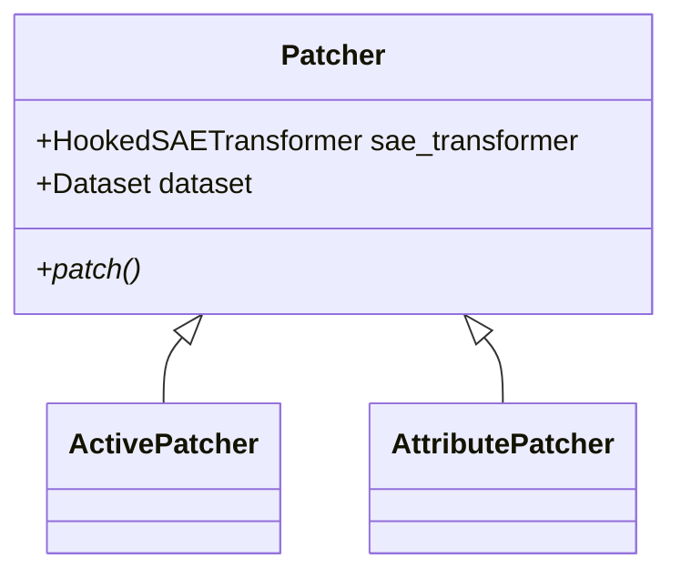

# Architecture 

The `architecture.md` consists of four sections:
- Goal & Challenges
- Decision
- Source-code organization
- Architecture 

## Goal & Challenges
The goal of this project is to enable sparse circuit identification for BLiMP dataset using sparse autoencoder and attribute patching. 

Challenges:
- The `SAELens` project does not support attribute patching.
- The diverging tokens in BLiMP dataset can appear anywhere throughout the sentence making intervention challenging.

## Decision
- Implement integrated gradient and stop gradient trick from [sparse feature circuit](https://github.com/saprmarks/feature-circuits) in the attribute patching [code](https://colab.research.google.com/github/jbloomAus/SAELens/blob/main/tutorials/Hooked_SAE_Transformer_Demo.ipynb). This is done using a composition where `HookedSAETransformer` will be a property in our `AttributPatching` class. 

## Source-code Organization
The `src` folder comprised of several core modules:
- `dataset.py`
- `model.py`

## Architecture
